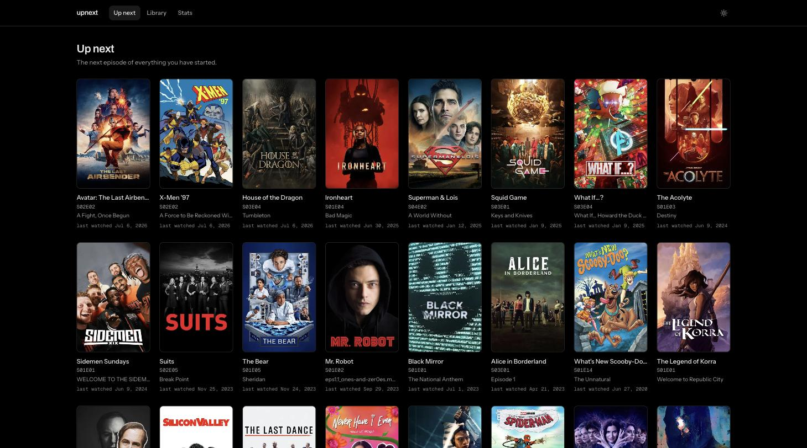
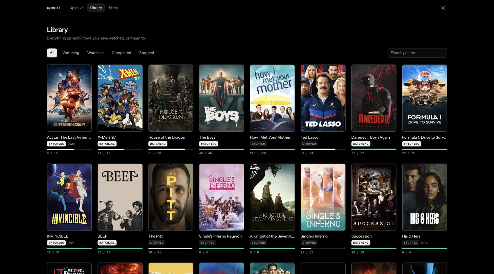
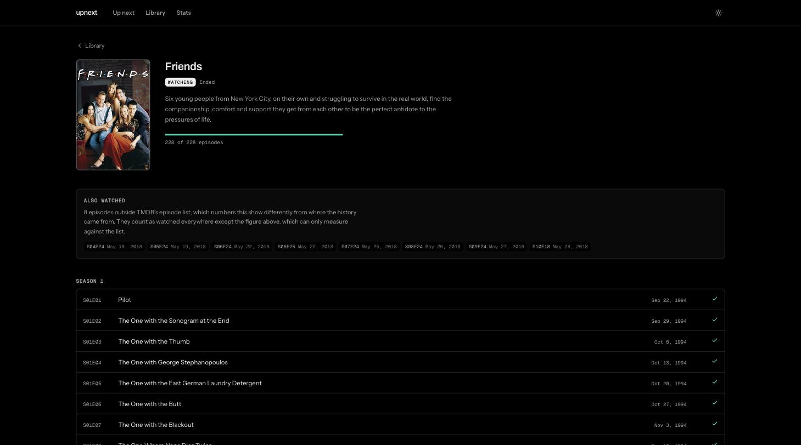
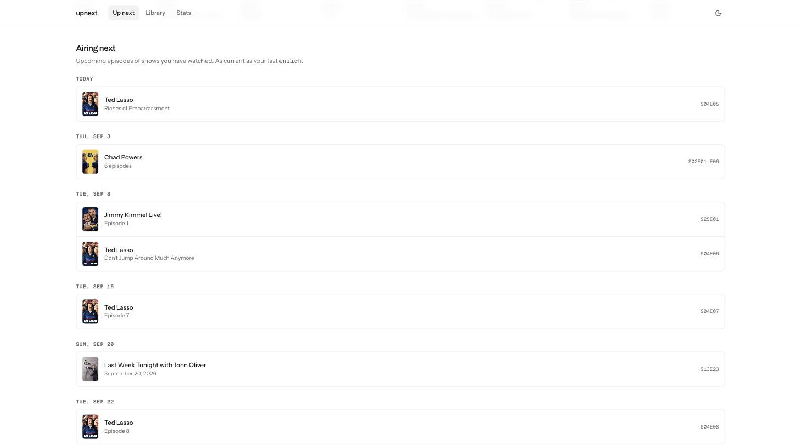
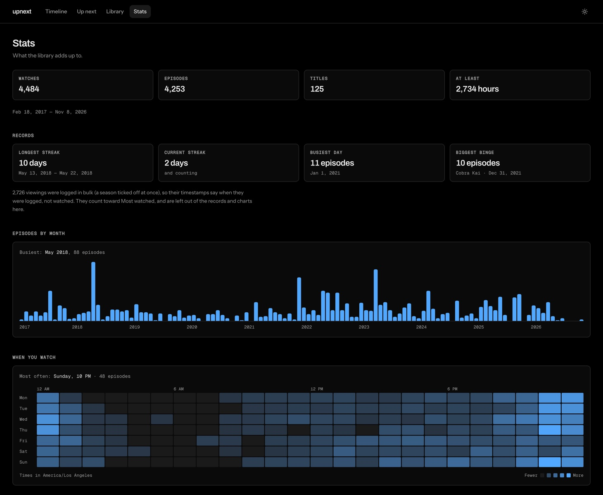

# upnext

A self-hosted TV tracker. Import your viewing history, match it against
[TMDB](https://www.themoviedb.org), and see what to watch next. Your whole
library is one SQLite file on your own machine.



## Features

- **Timeline** (the home page): unwatched episodes from the past month and everything coming up, for shows you're watching. Mark each one as you watch it.
- **Up next**: the next unwatched episode of every show you're part-way through. Search and sort it like the library.
- **Library**: everything you've watched or plan to, filterable by status: watching, paused (started, set aside for now), watchlist (not started), completed, stopped. Search by name, sort by recently watched, name, newest or progress. A show that has ended is filed completed once you've watched every episode. Change a show's status on its page, or remove a show you haven't watched any of; re-imports leave a removed show out.
- **Title pages**: every episode by season, what you've seen, and any viewings TMDB's list can't account for.
- **Stats**: totals and time watched; records (longest streak, busiest day, biggest binge); episodes by month and by year; a weekday-by-hour heatmap in your timezone; and your most-watched shows. History logged in bulk, such as a season ticked off at once, counts toward totals but not toward anything about when.
- **Imports from TV Time**: reads its GDPR export offline, and re-importing the same export changes nothing.
- **Light and dark mode**, with no account and no telemetry.

| | |
| --- | --- |
|  |  |
|  |  |

## Quick start

You need [`uv`](https://docs.astral.sh/uv/) (it fetches Python 3.15),
[`just`](https://just.systems) and [`pnpm`](https://pnpm.io).

```sh
just install                          # dependencies and git hooks
cp .env.template .env                 # then add your TMDB key (below)
just import ~/Documents/tv-time-data  # your TV Time export
just enrich                           # fetch episode lists and artwork
just ui                               # http://localhost:8000
```

**TMDB key.** Sign up at [themoviedb.org](https://www.themoviedb.org/signup) and
request a free **Developer** key under
[Settings → API](https://www.themoviedb.org/settings/api). Copy the v3
**API Key**, a 32-character hex string, into `.env` as `UPNEXT_TMDB_API_KEY`.
Only `enrich` and `move` need it.

> [!WARNING]
> A TV Time export contains live OAuth tokens. Keep it outside this repo.

`just doctor` checks your setup: whether the key is set, where the library is,
and how much of it is enriched.

## Usage

| Command | What it does |
| --- | --- |
| `upnext import <dir>` | Read an export into the library. Offline; no key needed. |
| `upnext enrich [--limit N] [--refresh]` | Match unenriched titles against TMDB. `--refresh` fetches every title again, for new seasons and episodes. |
| `upnext relink` | Re-match watches against stored episode lists, without the network. |
| `upnext move --title <id> --season <n> --to <tmdb_id> [--as-season <n>]` | Move a season's watches to the show they belong to, such as a spin-off filed as season 2 of its parent. |
| `upnext stats` | Summarise the library. |
| `upnext serve [--host --port] [--no-refresh]` | Serve the API, and the UI if it has been built. Refreshes every title from TMDB in the background on start, so new seasons show up. |

Each has a `just` shortcut (`just import`, `just enrich`, …). The API's
interactive docs are at `/docs`.

## Configuration

Settings come from the environment or `.env`.

| Variable | Default | |
| --- | --- | --- |
| `UPNEXT_TMDB_API_KEY` | none | Needed for `enrich`, `move` and the refresh on start |
| `UPNEXT_DB_PATH` | `~/.upnext/library.db` | The library. Delete it and re-import to start over. |
| `UPNEXT_TMDB_LANGUAGE` | `en-US` | Language for titles and overviews |
| `UPNEXT_TMDB_MIN_INTERVAL_SECONDS` | `0.05` | Pause between TMDB requests |
| `UPNEXT_TMDB_IMAGE_BASE` | `https://image.tmdb.org/t/p` | Where artwork is loaded from |
| `UPNEXT_HOST` / `UPNEXT_PORT` | `127.0.0.1` / `8000` | Where `serve` listens |

## How it works

- **Import** turns an export into rows. It reads five of TV Time's CSVs and
  ignores the rest, which is account data.
- **Enrich** looks each show up on TMDB by its TheTVDB id. Name search is only a
  fallback: first result only, and only when the year agrees. A show TMDB
  doesn't know stays as the export described it.
- **Matching** is exact on season and episode number, never approximate. Two
  differences in how seasons are numbered are resolved from evidence:
  - seasons labelled by year are resolved using TMDB's air dates;
  - a run split into seasons is mapped onto TMDB's single season, but only when
    the lengths agree and every existing match fits.
- **Progress and history are kept apart.** Viewings TMDB's list can't account
  for are listed as *Also watched*. They are never added to the progress figure.

## Development

```sh
just check              # Python: lint, types, tests, coverage (what CI runs)
just check-web          # front end: lint, types, tests, build
just serve              # API on :8000
just web                # Vite with hot reload on :5173, proxying /api
just api-types          # regenerate the client's types after changing the API
just test-integration   # tests that call TMDB (need a key)
```

The backend is Python with FastAPI and SQLite, organised as ports and adapters:

- `domain/` holds the models and matching rules;
- `application/` holds the use cases;
- `adapters/` holds the CLI, the API, TMDB, the TV Time importer and the store.

The front end in `web/` is React, Vite, TanStack Query and Tailwind. Its API
types are generated from the backend.

Architecture rules and conventions for contributors and coding agents are in
[`AGENTS.md`](AGENTS.md).
